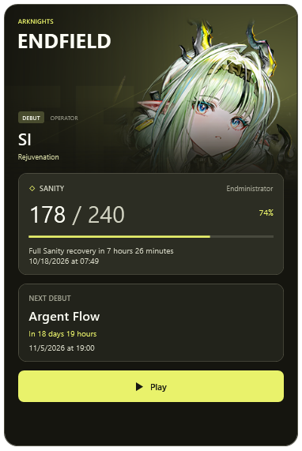
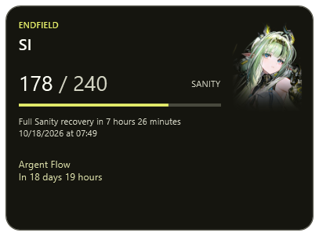
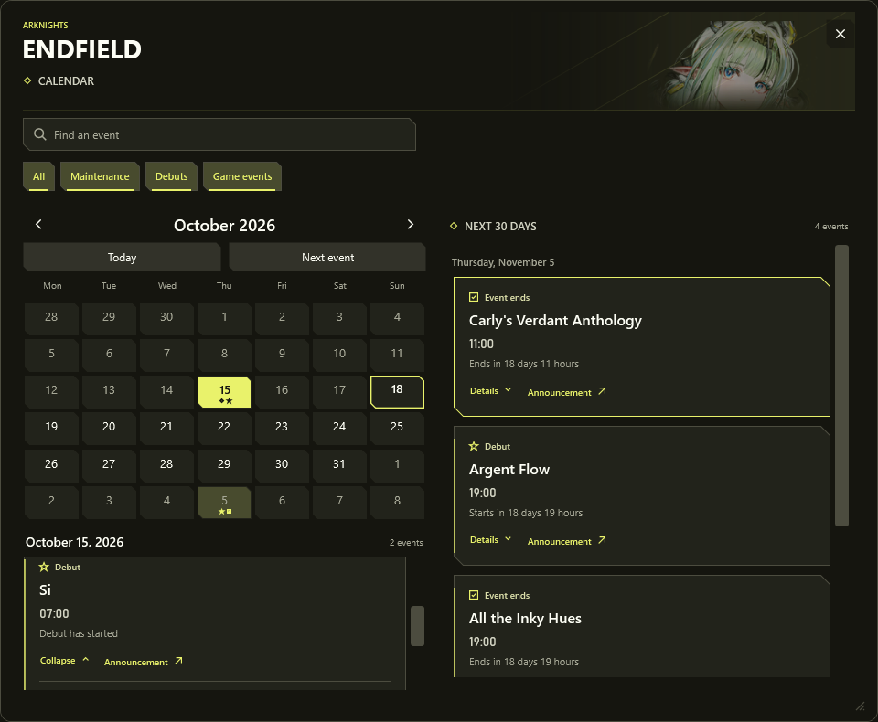
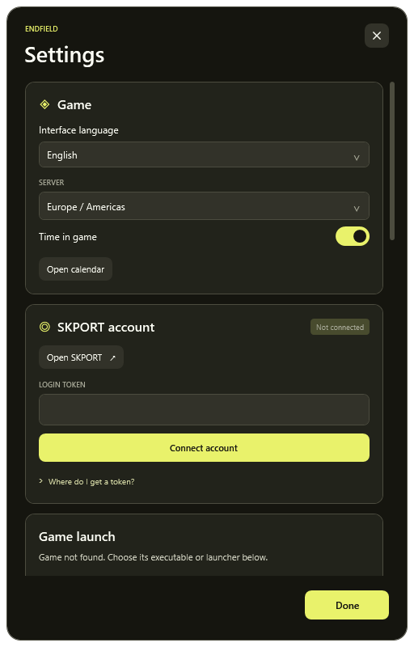

# Endfield Widget

A Windows desktop companion for **Arknights: Endfield**. Version **1.0**.

View Sanity, upcoming events and official announcements without opening the game. The widget stays on the desktop, adapts its colors to the featured operator and displays event times in the Windows time zone.

[Download for Windows](https://github.com/Sapientissimus/endfield-widget/releases/latest)

## Preview

Actual application views in English with sample account and event data. Click a screenshot to view it at full size.

<table>
<tr>
<td valign="top">
<strong>Normal</strong><br><br>
<a href="docs/screenshots/widget.png"></a>
</td>
<td valign="top">
<strong>Compact</strong><br><br>
<a href="docs/screenshots/compact.png"></a>
<br><br><strong>Micro</strong><br><br>
<a href="docs/screenshots/micro.png"></a>
</td>
</tr>
</table>

<details>
<summary>Calendar and settings</summary>

**Calendar** — upcoming dates, filters and official event details.

[](docs/screenshots/calendar.png)

**Settings** — language, server, layout scale and background opacity.

<a href="docs/screenshots/settings.png"></a>

</details>

## Features

- SKPORT Sanity balance, progress and estimated full recovery time.
- Automatic event, maintenance and debut banner dates from official announcements.
- A calendar with search, filters, upcoming events and expandable descriptions.
- Artwork for the current debut operator, with a matching color palette. Repeat banners do not replace it.
- Normal, compact and micro layouts with independent scale and appearance settings.
- Position locking, edge snapping, multiple monitors and desktop placement outside Alt+Tab.
- Steam game launch, tray controls and optional Windows startup.
- Fifteen interface languages, with official articles matched to the selected language where available.

## Download

1. Open the [latest release](https://github.com/Sapientissimus/endfield-widget/releases/latest).
2. Download `EndfieldWidget-Windows-v1.0.zip` and extract it to a permanent folder.
3. Open `EndfieldWidget.exe`.
4. Open **Settings** to select a language, choose the game server and connect a SKPORT account.

Windows 10 or Windows 11 and .NET Framework 4.8 are required. The application is portable; no installer is needed. English is selected on first launch. The application remembers an explicitly selected language.

Release executables are currently unsigned. Windows may display an unrecognized-app or unknown-publisher warning. `SHA256SUMS.txt` contains the EXE and ZIP hashes for checking download integrity.

Official dates are available without connecting an account. SKPORT is used to retrieve the selected character's Sanity. The widget does not collect items, automate gameplay or perform actions inside the game.

## Everyday use

- Drag the artwork area to move the widget. Use the context menu to lock its position.
- Choose a layout from the context menu or settings. Each layout keeps its own scale and position.
- Open the calendar from the widget or tray menu. Times follow the current Windows time zone, including daylight-saving changes.
- Use the tray icon to restore a hidden widget. Launching the application again also shows its existing instance.
- Enable **Start with Windows** to start about 15 seconds after signing in. This creates a task for the current user without elevation or a stored password. Battery use and unavailable network connectivity do not block startup.

Keep the portable folder in place after enabling startup. After moving it, switch startup off and on to register the new location. Turning startup off leaves the running widget open.

## Languages and announcements

| Interface | Official article edition |
| --- | --- |
| English | English |
| Français | French |
| Deutsch | German |
| Italiano | Italian |
| Español (Latinoamérica) | Latin American Spanish |
| Português (Brasil) | Brazilian Portuguese |
| Русский | Russian |
| Bahasa Indonesia | Indonesian |
| Tiếng Việt | Vietnamese |
| ไทย | Thai |
| 简体中文 | Global Traditional Chinese, converted for display |
| 繁體中文 | Global Traditional Chinese |
| 日本語 | Japanese |
| 한국어 | Korean |
| Українська | English |

Event dates are parsed from the English edition and matched to translated official articles by article ID. Names, descriptions and source links follow the selected edition. Simplified Chinese uses script conversion of global Traditional Chinese articles to retain the global server schedule. Source links open the original official edition. Announcements are not machine-translated.

Future dates are discovered automatically. The widget does not maintain a manual list of upcoming banner names or dates, and does not invent unannounced schedules. Cached data remains available when a source is temporarily unavailable; status messages indicate when an update could not be completed.

## Local data

Settings and caches are stored separately in `%LOCALAPPDATA%\EndfieldWidget`. The saved account token is protected for the current Windows user using DPAPI. The source repository and release downloads contain no connected account or personal profile.

Close the application from its tray menu before replacing the executable. Settings remain in the local profile folder. A diagnostic report can be exported from settings for troubleshooting; it excludes credentials and account identifiers.

## Support

Please use the [bug report form](https://github.com/Sapientissimus/endfield-widget/issues/new?template=bug_report.yml) for application problems. For suspected security vulnerabilities, please follow the private reporting instructions in [SECURITY.md](SECURITY.md).

## Build and test

From the repository root in Windows PowerShell:

```powershell
powershell -NoProfile -ExecutionPolicy Bypass -File .\source\build.ps1
powershell -NoProfile -ExecutionPolicy Bypass -File .\scripts\Catalog-Test.ps1
powershell -NoProfile -ExecutionPolicy Bypass -File .\scripts\Test.ps1 -Desktop
```

The build uses the C# compiler included with .NET Framework and embeds the views, portraits and translation catalogs. No NuGet packages are required. The executable is created in the repository root.

See [TESTING.md](TESTING.md) for isolated regression and startup checks, and [CONTRIBUTING.md](CONTRIBUTING.md) for bug reports and contributions.

## License

Original project code, interface translations and documentation are licensed under the [MIT License](LICENSE). Copyright (c) 2026 Sapientissimus.

Game artwork, names, characters and original official announcement content are excluded from that license and belong to their respective rights holders. See [THIRD-PARTY-NOTICES.md](THIRD-PARTY-NOTICES.md).

The publisher's fan-content rules are available in the [Arknights: Endfield Fan Content and Streaming Guidelines](https://endfield.gryphline.com/en-us/news/4497). This project does not grant additional rights to game materials.

This is an unofficial companion and is not affiliated with the game's publishers.
